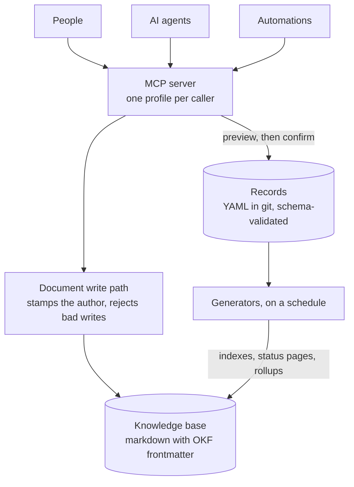
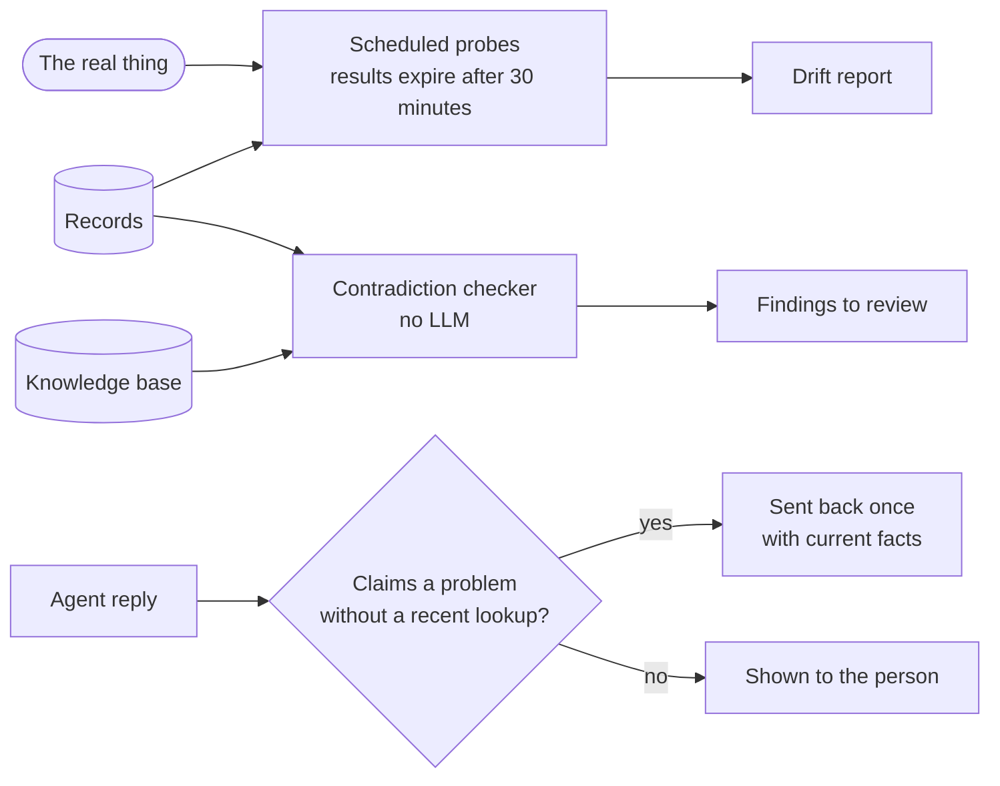

# How we run Atlas

> This describes Atlas as we run it in production. The code in this repository is a modular version built for others to install, and it is still being assembled. It does not yet include everything described here.

Atlas is a shared source of truth for people and AI agents who work on the same things over months. Every agent session, in any tool, reads and writes it through one MCP server. It knows who is asking, records who changed what, checks its own facts against the real world, and does most of its own upkeep.

We built it because our agents started every session from zero and acted on notes that had gone out of date.

## What it holds

Structured records kept in git: projects, tasks, rules, the things we operate, and the people and automations allowed to act. Each record is a YAML file validated against a Pydantic schema, and references between records are checked on every write.

Next to the records is a knowledge base of markdown documents, one folder per project. Every document carries frontmatter in Google's [Open Knowledge Format](https://github.com/GoogleCloudPlatform/knowledge-catalog/blob/main/okf/SPEC.md) (OKF), which says what kind of document it is, who wrote it, when, and where its claims came from. We use OKF's fields and keep our own folder layout and indexes. Agents write the documents, and the summary pages are generated from the records.

## Everyone works from the same facts

Each fact has one home. A person at a terminal, a chat session on a phone and an unattended job all query the same record and get the same answer. Each record of something we run also states what condition it is supposed to be in, and changing that takes a written reason. Something that was paused deliberately is never reported as broken, because the record says it was paused and why.

## It knows who is asking

The server speaks MCP over streamable HTTP, and remote clients authenticate with OAuth. Every caller has a profile, whether it's a person or an automation. The profile names the identity behind the caller and the kinds of action it may take, from read-only through reversible changes up to irreversible ones. It also says where a confirmation request should be sent. People and automations with very different levels of trust can share one store this way.

Rules are records as well. A person's standing rules load into every session and take priority over the agent's defaults. A generated report lists which rules are enforced by code and which are only written down, so we know which ones depend on an agent remembering them.

## Every change has an author

All document writes go through one path. It stamps OKF's `generated` field with the agent, model or process that made the change and the time. It rejects writes that are empty, still contain placeholder text, or would replace a document with a much shorter one. Changes to records are previewed first and applied on a second, confirming call. Agent sessions are themselves recorded, along with the tools they called.

OKF's `sources` field records where a document's claims came from, and `stale_after` sets a date past which it shouldn't be trusted. The write path won't let an agent name a person as a document's author. That gives every session a simple rule for reading the knowledge base: a statement belongs to a person only when it's a quote cited to them. Anything else is an agent's claim and gets checked before it's relied on.

When something looks wrong, we can trace it to the session that wrote it. A confused agent can't blank a page or leave a half-finished edit behind. We adopted the OKF fields after agents had treated something an earlier session wrote as something a person had decided.

## Facts are checked against the real thing

Scheduled probes compare the records with what is actually true and report any drift. A probe result older than 30 minutes is discarded and re-run. A separate checker, which uses no LLM, scans the documents for statements that contradict the records. It is tuned to flag only what it is sure about, so its findings get acted on.

Every capability we've built is listed in a ledger with evidence of use. Each one is marked live, idle, dead or unknown, and unknown means nobody has measured it. It exists because we kept building things and then forgetting we had them.

Agents also get checked. Before a reply is shown, a Claude Code Stop hook looks for claims that something is broken. If the session made that claim without a recent lookup, the reply goes back once with current facts attached. We added this after agents reported failures that weren't happening.

## Decisions stay in the words of whoever made them

Every 15 minutes a scanner reads the session transcripts, finds the messages where a person decided something, and appends their exact words to that project's decision log. A model picks out the decisions and the project they belong to, and it never rewrites the words. Duplicates are skipped. When a later decision reverses an earlier one, the two entries link to each other. Months later, "why did we do it this way?" has an answer, and nobody had to take notes.

## Work is tracked to a finish

Every task records its next action and a closure test, which is a plain statement of how to tell the task is done. Automations open tasks themselves when they find a problem. Anyone, person or agent, can pick up a task cold and check whether it is really finished.

## A new session starts where the last one stopped

Opening a project loads its record, recent commits, decision log and working documents in one call, and warns if the record has fallen behind the documents. The next session can be a different person using a different tool, and it still starts with the full picture.

## It maintains itself

Indexes, status pages and rollups are regenerated from the records on a schedule, so nobody edits them by hand. The knowledge base has a semantic index (ChromaDB with a small local embedding model), and every search agents run against it is logged. A daily report uses that log to list documents nobody has ever retrieved, documents that are heavily used but haven't been updated in a long time, and searches that found nothing useful. The report recommends and a person decides. Nothing is archived automatically.

## Building your own

Most of Atlas is assembled from existing pieces:

- the MCP Python SDK for the server
- Pydantic for record schemas
- OKF for document frontmatter
- ChromaDB for semantic search
- Claude Code hooks for the checks on agents
- systemd timers for the schedule
- git under all of it

What we wrote ourselves is the record schemas, the write path, the generators and the checks. If you build your own, the tools matter less than these parts:

- one store, with an intended state on everything you run
- a profile for every caller
- a single write path that records the author
- checks against the real thing that don't depend on an LLM
- decisions captured word for word

Start with the store and the write path. Add a check each time you catch something drifting.
